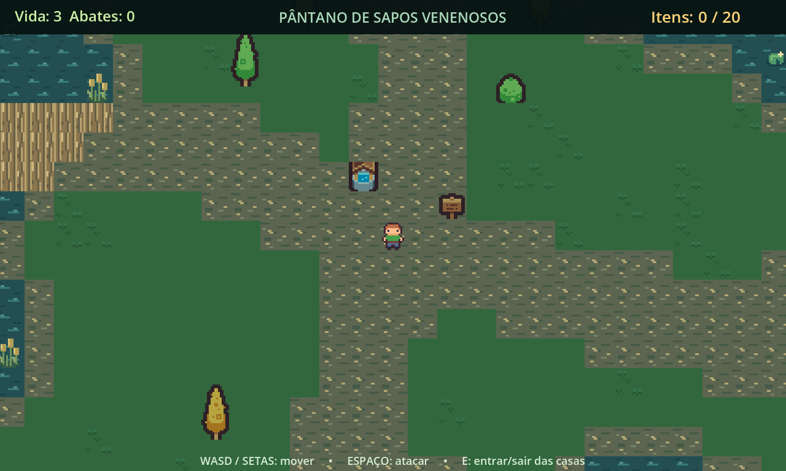

# Pântano de Sapos Venenosos

- Tema: Pântano de sapos venenosos.
- Tipo: Coleta — juntar 20 itens pela arena.
- Modo: Horda.

## Como jogar

Abra `project.godot` no Godot 4.7.1 e aperte F5.

- WASD ou setas: andar.
- Espaço: atacar.
- E: entrar e sair das casas.
- Enter na tela final: jogar de novo.

Junte 20 cogumelos para vencer. Você começa com três vidas e perde se elas acabarem.
Um cogumelo aparece a cada três segundos. Os sapos saem dos lagos e perseguem o jogador.
O ataque serve para se defender; abates não substituem a coleta.
Use as passarelas para atravessar os lagos. Dentro das casas você fica protegido.

Cenário: [Tiny Town, de Kenney](https://kenney.nl/assets/tiny-town), licença CC0. Personagem fornecido pelo professor.
