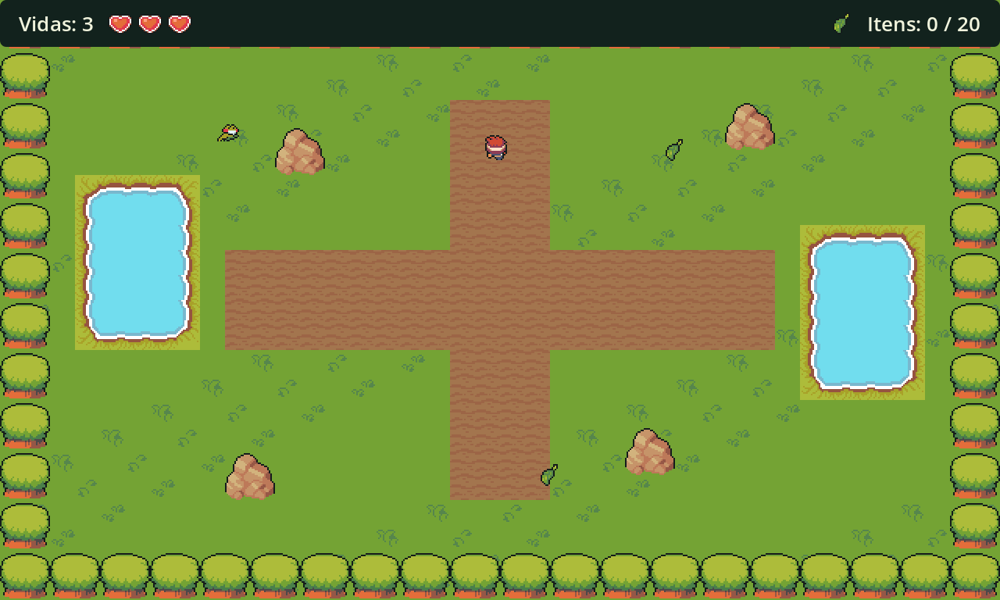

# Pântano de sapos venenosos

Meu projeto de Jogos Digitais II é um jogo de Coleta em modo Horda, com visão de cima.

| Carta | Escolha |
|---|---|
| Tema | Pântano de sapos venenosos |
| Tipo | Coleta |
| Objetivo | Juntar 20 itens que surgem pela arena |
| Modo | Horda |

Esta é a arena durante uma partida de Coleta:



## Como jogar

Na Coleta, preciso reunir **20 folhas** enquanto desvio dos sapos. Começo com três vidas e perco uma ao encostar neles. Depois de cada dano, tenho um segundo de invencibilidade. Os sapos aparecem cada vez mais rápido, com limite de 48 na arena. As folhas surgem em pontos livres a cada três segundos.

| Controle | Ação |
|---|---|
| WASD ou setas | Mover o personagem |
| Enter ou Espaço | Confirmar o botão selecionado |
| Recomeçar | Iniciar outra partida com três vidas |

## Abrir o projeto

Usei a **Godot 4.6.3**, com o renderizador GL Compatibility. Basta importar `project.godot` na Godot.

Na `main`, **F5** abre a Coleta. Para jogar o exercício da Aula 09, abro `scenes/aula09_sobrevivencia.tscn` e aperto **F6**: o objetivo é aguentar **60 segundos**, com três vidas e sem coletáveis. Na tag `aula-09`, F5 abre diretamente a sobrevivência.

Mantive os dois modos nas mesmas cenas e scripts. A cena `scenes/aula09_sobrevivencia.tscn` muda o objetivo e ativa o relógio. Na Coleta, o relógio fica desligado e a vitória depende das 20 folhas.

## Entregas

| Tag | O que registrei |
|---|---|
| `aula-08` | Cenário com colisões e personagem controlável; esse incremento também já inclui horda e vidas |
| `aula-09` | Sobrevivência por 60 segundos, horda, três vidas, placar, vitória, derrota e reinício |

A Coleta já tem uma partida completa. Ainda preciso trabalhar nos estados e na navegação dos inimigos, revisar o desempenho com a horda cheia e preparar a exportação e a página de publicação. Por enquanto, os sapos perseguem em linha reta e podem ficar presos nas pedras e lagoas.

## Testes

Na raiz do projeto, uso estes comandos:

```sh
godot --headless --path . --editor --import
godot --headless --path . --script tests/test_arena.gd
godot --headless --path . --script tests/test_atores.gd
godot --headless --path . --script tests/test_partida.gd
godot --headless --fixed-fps 60 --path . --script tests/test_sobrevivencia.gd
godot --headless --path . --quit-after 120
```

Os testes usam as cenas do jogo e a física da Godot para conferir movimento, colisões, dano, coleta, horda e o ciclo da partida. No teste de sobrevivência, deixo o relógio completar os 60 segundos simulados para conferir a vitória.

Se o ambiente não permitir salvar na pasta pessoal, configuro os diretórios locais antes:

```sh
mkdir -p /tmp/projetop2-config /tmp/projetop2-cache /tmp/projetop2-data
export XDG_CONFIG_HOME=/tmp/projetop2-config
export XDG_CACHE_HOME=/tmp/projetop2-cache
export XDG_DATA_HOME=/tmp/projetop2-data
```

## Créditos

Usei os sprites do **Ninja Adventure**, de [Pixel-boy](https://pixel-boy.itch.io/) e [AAA](https://www.instagram.com/challenger.aaa/), com licença **CC0**. Escolhi o Hunter para o jogador, o sapo pequeno para os inimigos e a TeaLeaf para os itens. Mantive os PNGs originais, a [licença](sprites/ninja-adventure/LICENSE.txt) e o [README do pacote](sprites/ninja-adventure/README.original.md).

- [Página oficial do pacote](https://pixel-boy.itch.io/ninja-adventure-asset-pack)
- [Espelho usado no download, em versão fixa](https://github.com/MarioLDD/Kuroshiro-adventure/tree/0476a561d5e6da477d5d2de2e738f0595754adbb/Assets/NinjaAdventure)
- [Catálogo dos arquivos que selecionei](sprites/ninja-adventure/README.md)

Registrei as fontes e a assistência usada nos comentários dos scripts. O [DEVLOG](DEVLOG.md) reúne as etapas do projeto.
